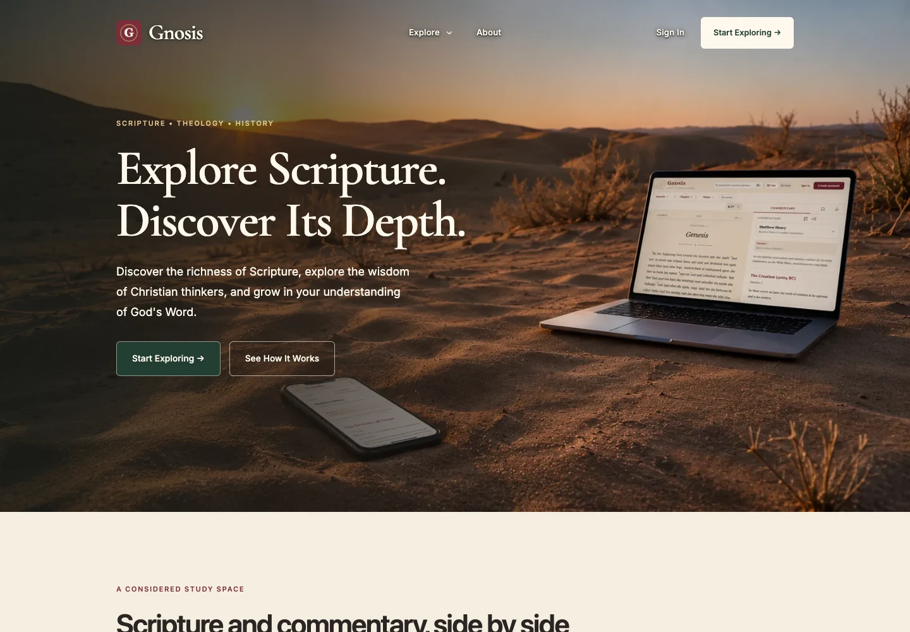
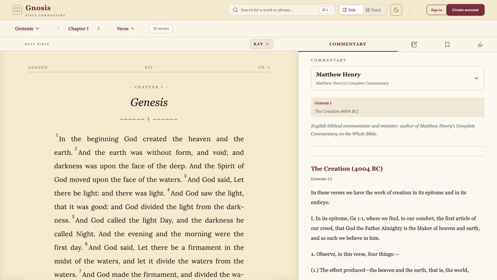
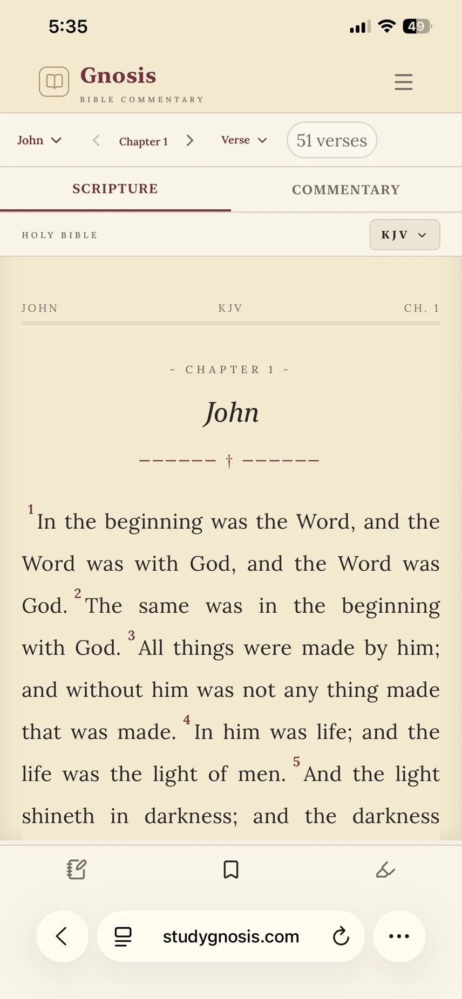
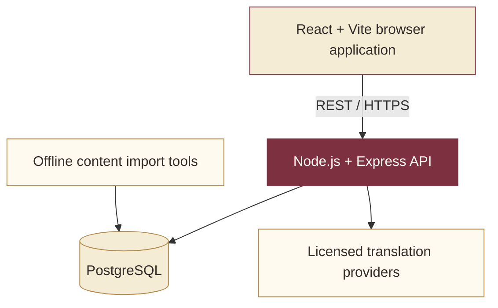

# Gnosis

**Scripture · Context · Understanding**

A full-stack Bible study platform that brings Scripture, historical commentary, and personal study tools into one focused reading experience.

### [Explore the live application →](https://studygnosis.com)

Built by [Yonatan Demissie](https://github.com/yoni871) · React · Vite · Node.js · Express · PostgreSQL

*The actual Gnosis landing page. Its existing background is generated artwork; the reader captures below show the real application interface.*

## The product

Studying a passage often means switching between a Bible, commentary, and personal notes. Gnosis keeps those activities together: read a chapter, consult historical commentary, and return to the text without losing your place. Its burgundy accents, gold details, and parchment reading surfaces give the experience a consistent visual identity across screen sizes.

**[Open Gnosis](https://studygnosis.com)** · [Explore the engineering](#engineering-challenges-and-solutions) · [Meet the developer](#developer)

## Desktop Scripture and commentary

*Genesis 1, KJV, with Matthew Henry's commentary. Desktop layouts place the biblical text and its context side by side.*

## Mobile reading

  

*The responsive web application on a phone: John 1, chapter controls, Scripture and Commentary tabs, and study-tool navigation. This is a real mobile capture.*

## Features at a glance

- **Scripture and commentary:** book, chapter, and verse navigation; translation selection; integrated historical commentary.
- **Search:** passage discovery with paginated results.
- **Personal study:** account-based bookmarks, highlights, notes, and saved reading progress.
- **Responsive interface:** side-by-side desktop study and a tabbed mobile reading experience.
- **Original Language Analysis — initial implementation:** word-level Hebrew and Greek study for Genesis 1 and Philippians 3. Full-canon coverage is future work; availability in the live app depends on production rollout.

### Original Language Analysis

The initial implementation connects a selected passage to original words, transliteration, short glosses, expanded grammar, and a word-detail panel with lemma and Strong's information. Occurrence lookup is limited to the imported corpus. Hebrew uses right-to-left text; Greek uses left-to-right text.

An authentic screenshot of this feature was not present in the reviewed repository assets, so this showcase does not substitute a mockup. The feature's documented initial scope is Genesis 1 and Philippians 3; it does not imply full-Bible language coverage.

## Technology stack

| Layer | Technologies and responsibilities |
| --- | --- |
| Frontend | React, Vite, React Router, Tailwind CSS; responsive reading layouts and study interactions |
| API | Node.js, Express; REST endpoints for passages, commentary, search, and user study records |
| Persistence | PostgreSQL, `pg`, `node-pg-migrate`; relational content, user data, and versioned migrations |
| Authentication | bcrypt password hashing, JWT access tokens, rotating refresh-token sessions |
| Quality | Vitest, React Testing Library, backend and importer tests, PostgreSQL integration tests, GitHub Actions |
| Hosting | Vercel frontend and Neon PostgreSQL |

## High-level architecture

The browser handles presentation and reading interactions. The API validates requests, applies authentication to personal study operations, and retrieves relational data. Offline import tools populate biblical content separately from ordinary application requests. Provider-backed translations remain subject to their licensing and availability.

## Engineering challenges and solutions

| Challenge | Implementation |
| --- | --- |
| **Model interconnected biblical content** | Relational entities connect books, chapters, translations, verses, commentary ranges, and user study records. Keys, constraints, and indexes support consistent passage lookup. |
| **Import large biblical datasets reliably** | Dedicated Scripture and commentary import tools map source content to passage references. The offline Bible importer validates input, uses a transaction, reuses chapter lookups, and skips translations that already contain verses. |
| **Protect accounts and personal study data** | Password hashing, short-lived access tokens, and rotating refresh tokens support authentication. Refresh credentials are hashed in storage and carried in HttpOnly cookies; session revocation and token-reuse detection handle logout and invalid reuse. |
| **Evolve the database safely** | Versioned migrations and catalog checks make schema changes reviewable. Disposable PostgreSQL integration tests exercise migrations and application behavior. |
| **Reduce repeated work in the reader** | Route-level lazy loading, bounded chapter caching, commentary caching, paginated search, and responsive image delivery reduce unnecessary loading and requests. |
| **Keep study tools usable on small screens** | Responsive layouts adapt parallel desktop content to mobile tabs. The language-analysis implementation adds dialog focus handling, scrolling word tables, and direction-aware text. |
| **Validate changes across the stack** | GitHub Actions runs frontend tests and build checks, backend tests, offline importer tests, and database checks against PostgreSQL 14 and 18. |

## Developer

**Yonatan Demissie** is a software engineer with a B.S. in Computer Science from Texas Tech University. Gnosis demonstrates his work across React interfaces, REST API development, relational data modeling, content ingestion, authentication, testing, and responsive product design.

**[GitHub profile →](https://github.com/yoni871)** · **[Try Gnosis →](https://studygnosis.com)**

---

About this showcase and its visuals

This is a public, view-only portfolio repository. Application development and production code remain in the separate Gnosis repository. This showcase distributes only documentation and selected product images; it contains no application source, backend files, schemas, datasets, environment files, or credentials.

The visuals reuse existing Gnosis assets:

- `hero.webp`: the signed-out landing-page screenshot, converted to WebP. The page includes the owner's existing generated sunset artwork.
- `scripture-reader.webp`: the owner-supplied Genesis 1 desktop capture, with browser chrome removed and a proportional WebP export.
- `mobile.webp`: the existing WebP delivery copy of the owner-supplied John 1 mobile capture, reused without re-encoding.

The reader captures display the KJV and Matthew Henry commentary. No licensed modern translation text, personal notes, account details, or third-party stock photography has been added. Screenshot content has not been fabricated. Original Language Analysis data is documented as sourced from STEPBible and Tyndale House under CC BY 4.0; no language dataset is redistributed here.

